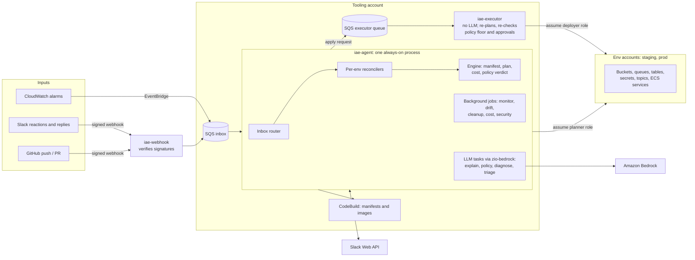

# zio-iae: Infrastructure as Effects

zio-iae makes the cloud resources a program uses part of its type. A ZIO app that needs an S3 bucket asks for
one in its environment, just as it asks for any other service, and an always-on agent turns that declaration into
real, policy-gated AWS changes and deployments.

Status: early. The library and the agent run end to end locally against [Floci](https://github.com/floci-io/floci)
(an AWS emulator), but not yet against real AWS accounts. The design and milestones are in [`SPEC.md`](SPEC.md).

## What it is

The project has two parts:

| Part | Modules | What it does |
|---|---|---|
| **Library** | `iae-core`, `iae-aws`, `iae-aws-client`, `iae-testkit` | Typed resource capabilities (`Bucket`, `MessageQueue`, `Table`, `Secret`, `Topic`, `Service`), AWS providers for them, a thin ZIO AWS client, and Floci test layers |
| **Agent** | `iae-engine`, `iae-agent`, `iae-executor`, `iae-webhook`, `iae-cli` | A deterministic plan, policy, apply and deploy engine; the always-on agent that runs it on every push and keeps watching afterwards; and the `iae` CLI |

### In the app: infrastructure as a ZIO requirement

```scala
object Uploads extends Bucket.Id(LogicalId("uploads"), BucketSpec(versioning = Versioning.Enabled))

object PhotoApp extends AwsInfraApp(AppName("photo-app"), Bucket.readWrite(Uploads)):
  def program: ZIO[Bucket[Uploads.type], Any, Any] =
    for
      key <- ZIO.fromEither(ObjectKey.from("photos/hello.txt"))
      _   <- ZIO.serviceWithZIO[Bucket[Uploads.type]](_.put(key, ZStream.fromChunk(bytes), Some("text/plain")))
    yield ()
```

The declaration (`Bucket.readWrite(Uploads)`) is one value used three ways:

1. **At runtime** it provides the ZIO layer the program runs with. The layer binds to the existing bucket and
   checks that its spec matches; it doesn't create anything.
2. **At deploy time** it is the desired state. `photo-app --iae-manifest` prints it as JSON without touching AWS,
   and the engine plans against it.
3. **For security** it generates the app's IAM policy. The program asked for `Bucket`, so it gets read and write
   on that one bucket. Ask for `BucketReader` instead and it gets read only.

The compiler enforces the link. A program can't use a resource it didn't declare, a queue only accepts its
declared message type, and a topic can only subscribe queues of the matching type.

### Around the app: an agent that operates it

Push to `main` and the agent:

- builds the manifest at that commit (in CodeBuild) and plans the change against what is actually in AWS;
- projects what the change will cost each month;
- judges each change against the team's approval policy, written in plain English in `.iae/POLICY.md`;
- asks for approvals in Slack where the policy requires them, and verifies them;
- applies the change, then deploys the app with a blue/green canary and rolls back on its own if the canary fails.

Between pushes it keeps working:

- It watches the live services' alarms and health, triages alerts with an LLM, and can propose a rollback.
- It reports drift along with who made the change (from CloudTrail), and reverts it where the policy allows.
- It cleans up: deleting orphaned resources once they pass the retention period, pruning old task definitions and
  images that nothing runs or rolls back to, and orphaning apps the repo no longer declares. It reports idle
  resources.
- It watches cost: right-sizing (from Compute Optimizer) and storage savings, the bill from Cost Explorer beside its
  own projections, and spending anomalies.
- It audits security: permissions the app never uses, its own configuration checks, and findings from Security
  Hub, GuardDuty, Inspector and Access Analyzer. Active threats go straight to the owners.

People are in the loop through Slack: they approve, reject, ask questions and give guidance in the run's thread.

## Why it's better than traditional IaC

Terraform, CDK, Pulumi and CloudFormation work like compilers for infrastructure. A human writes the desired
state in a separate language, CI runs `plan` and `apply` when the code changes, and then the job ends. zio-iae
differs in two ways.

**1. The infrastructure is the program's types, not a second codebase.**

| | Traditional IaC | zio-iae |
|---|---|---|
| **Source of truth** | HCL/YAML/a separate program, kept in sync with the app by hand | The app's own `Infra[R]` value; the program's type says what it needs |
| **Mismatch between code and infra** | Found at runtime (a missing env var, a wrong ARN, `AccessDenied`) | A compile error, or a fail-fast check at startup that names the resource |
| **IAM** | Hand-written, usually broader than needed, and drifts from the code | Generated from the capabilities the code uses, then narrowed further from observed unused access |
| **State** | A state file to store, lock and repair | None. The cloud's APIs and `iae:*` tags are the state; git holds the desired state and Slack holds approvals |
| **Testing** | Separate tooling, often against real accounts | The same capabilities run against Floci in containers or in memory, in ordinary ZIO tests |

**2. An agent operates the infrastructure after the apply, under a policy you write.**

| | Traditional IaC | zio-iae agent |
|---|---|---|
| **When it runs** | When someone pushes; idle otherwise | Always: on pushes, alarms, drift, timers and Slack replies |
| **Approval rules** | All or nothing: a protected CI environment, or nothing | Per change, from a plain-English policy: what can just go ahead, who must approve, what's never allowed. A built-in floor of rules can't be talked down |
| **Change review** | Reviewers read a raw `plan` diff | Each change is explained in plain language, with its risk, its projected monthly cost, and the policy clauses that apply |
| **Delivery** | A pipeline someone builds and maintains; a failed build waits for a human | Build, plan, canary and rollback are built in; a failed build or deploy gets a diagnosis and a proposed fix |
| **Incidents** | Someone is paged and works out the cause by hand | Alerts are triaged against recent deploys and metrics in the alert's thread; a rollback is proposed and goes through the policy |
| **Drift** | Found at the next `plan`, often weeks later, and overwritten | Reported when it's found, with who changed what, and reverted or kept as the policy says |
| **Cleanup and cost** | Orphans pile up; sizes stay until someone reads the bill | Orphans and old versions cleaned up through the policy; right-sizing and storage savings reported, and the bill compared with each plan's projected cost |
| **Security** | Periodic reviews, or a scanner whose findings land in a backlog | Unused permissions, misconfigurations and Security Hub, GuardDuty, Inspector and Access Analyzer findings reported with a proposed fix; threats escalated at once |
| **Compliance evidence** | Assembled by hand before an audit | Recorded on every change (commit, plan, verdict, approvers, result) and filed in AWS Audit Manager |

None of this gives the LLM unchecked power. It only gets tools, never raw AWS or shell access. Every change it
wants goes back through the deterministic engine and the policy. Approvals come from people and are verified
against Slack's API, so the agent can't produce them. Only a separate, LLM-free executor can assume the roles that
change AWS (see below).

## Architecture



### The pieces

- **`iae-core`**: the model. Resource kinds and their capability traits, `Infra[R]`, manifests, plans and
  changes, and the provider SPI (drivers, discovery, watch, pricing, attribution).
- **`iae-aws-client`**: a small ZIO client for the AWS APIs zio-iae uses (SigV4, query, JSON and REST protocols),
  with retries inside the client and typed errors outside.
- **`iae-aws`**: the AWS providers. They create and converge resources, discover them by tag, generate IAM,
  deploy services blue/green behind an ALB with canary gates, and implement the watch, pricing and attribution SPIs.
- **`iae-engine`**: the deterministic core. It plans (observed state to manifest, as a dependency-ordered list of
  changes with a risk level and cost each, identified by a content hash), builds the facts each change is judged
  on, combines the policy's verdict with the built-in floor, and applies idempotently behind a commit guard.
- **`iae-agent`**: the always-on process. An inbox router feeds one reconciler fiber per env, which runs the
  pipeline: build the manifest, plan, judge, ask in Slack, hand off to the executor. Background jobs run as fibers
  in the same process. LLM work runs as bounded [zio-bedrock](https://github.com/jamesward/zio-bedrock) tasks
  with fixed tool sets.
- **`iae-executor`**: the only principal allowed to change AWS. Before it applies anything, it checks out the
  commit itself, recomputes the plan and requires the same hash, recomputes the policy floor, and verifies the
  Slack approvals with its own token. A compromised agent can propose changes but can't make them.
- **`iae-webhook`**: a small HTTP server (for Lambda behind the Lambda Web Adapter) that verifies GitHub and Slack
  signatures and enqueues identifiers to SQS. The agent has no inbound endpoint and re-reads everything from the
  source.
- **`iae-cli`**: the same engine from a laptop: `iae plan`, `iae apply`.
- **`iae-testkit`**: `FlociLayer` (Testcontainers), an in-memory cloud, and fakes for Slack, the model and the AWS
  services Floci lacks.

### State without a state file

The agent holds only a working set in memory: reconciler mailboxes, pending approvals, and conversations. It can
throw all of that away. Desired state and policy come from git. Infra state comes from the cloud's APIs and the
`iae:*` tags on each resource (spec hash, commit, deployed image and color). Approvals and conversations come from
Slack. On restart the agent reconciles every env, finds its open threads in Slack, and drains the inbox, so a
restart neither repeats nor loses an approval or an alert.

## Try it

Docker is required: the tests and the harness start Floci containers.

```bash
./sbta "Test / compile; testFull; stage"   # full build and tests
./sbta agent/Test/run                      # local harness at http://localhost:8088
```

The harness runs the real webhook, agent and executor against a Floci per account. It has a fake Slack channel you
can act in as different people, a panel that edits the example repo and pushes, a controllable clock, and
scenario buttons (a bad deploy, drift, an incident and rollback, cleanup). With `AWS_BEARER_TOKEN_BEDROCK` and
`BEDROCK_MODEL_ID` set, a real model evaluates the policy. See [`AGENTS.md`](AGENTS.md) for running the example app
and the `iae` CLI against a local Floci.

## License

Apache 2.0
